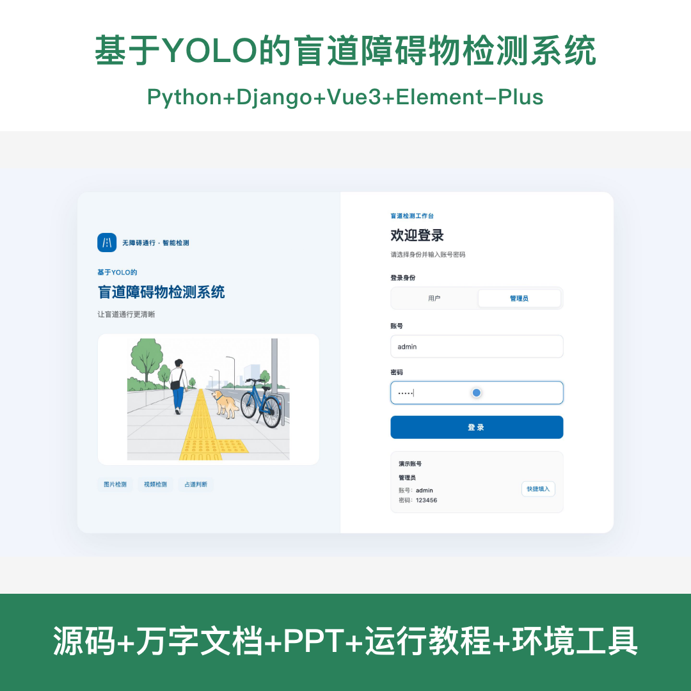
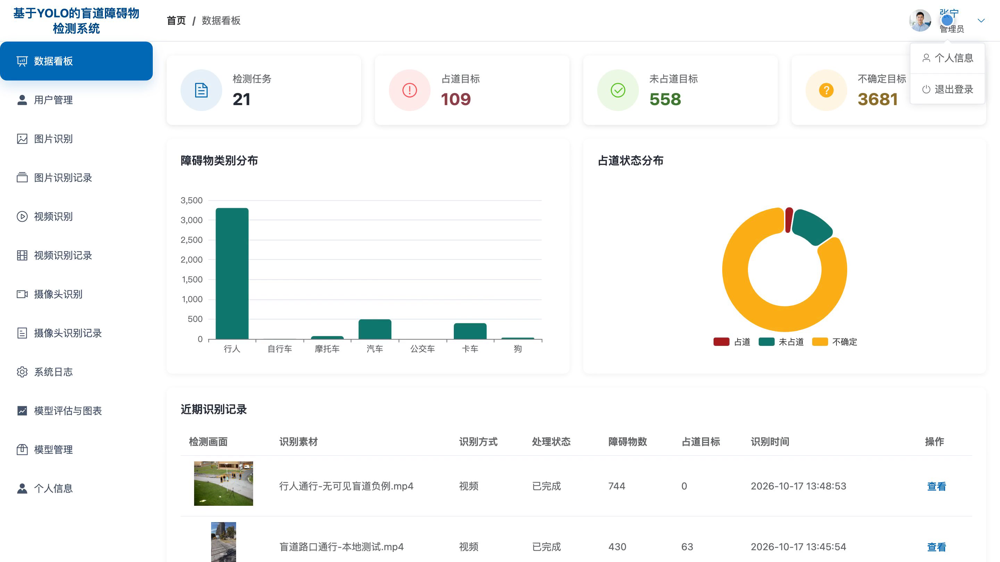
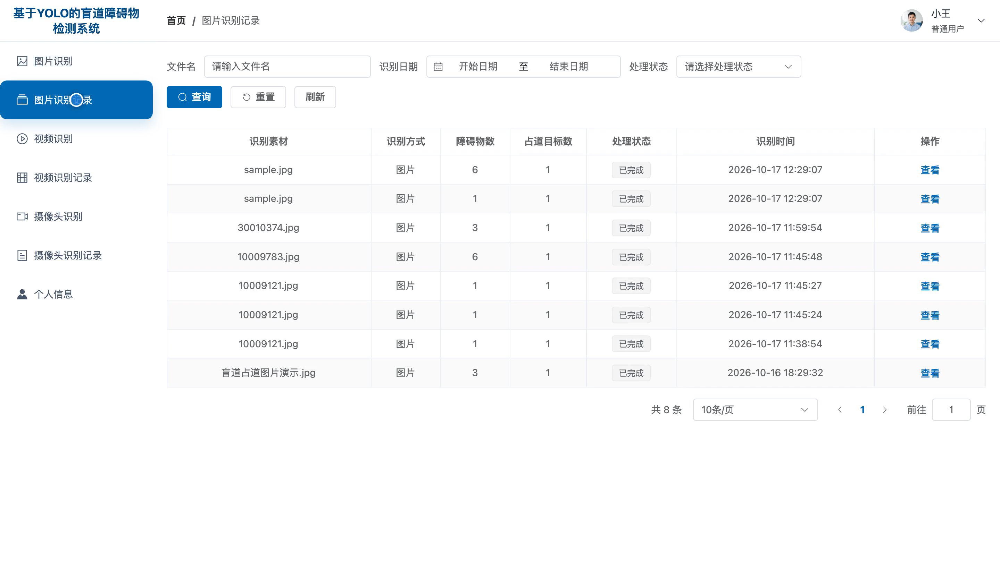
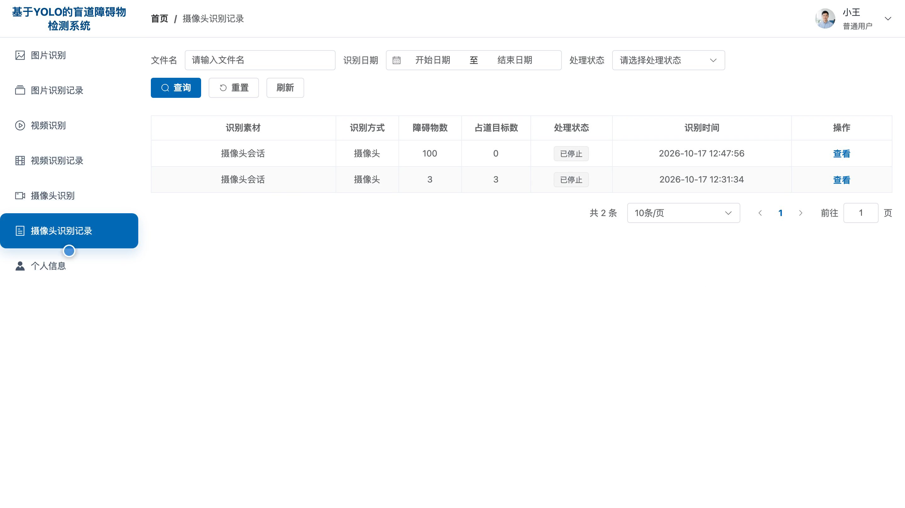
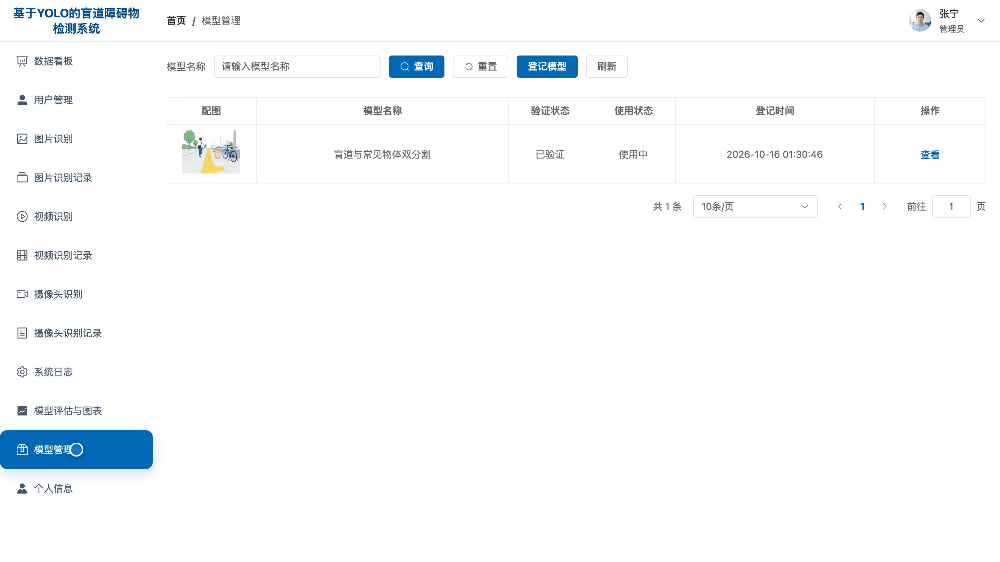
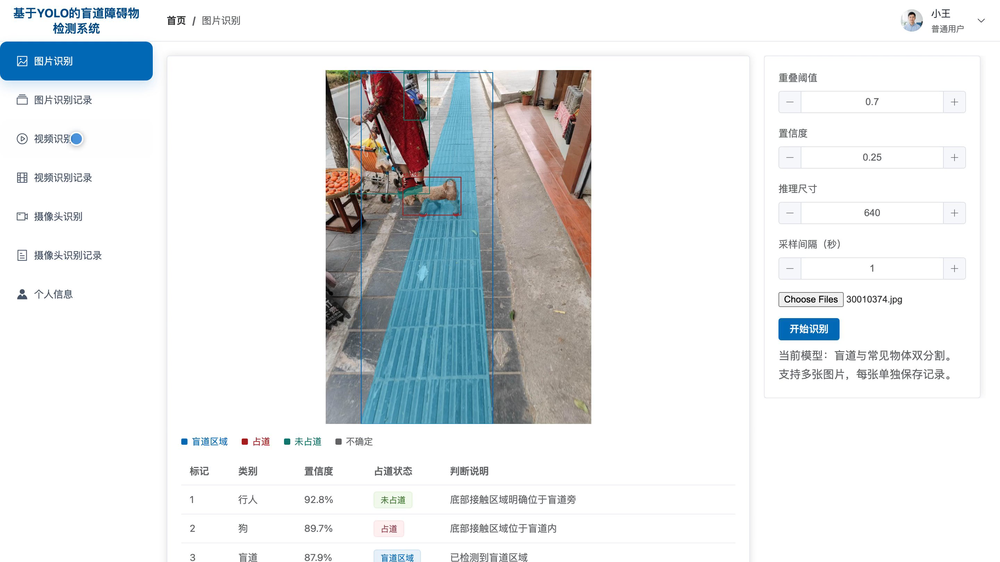
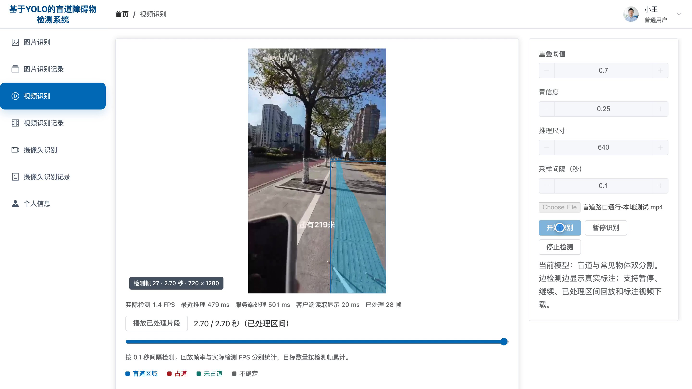
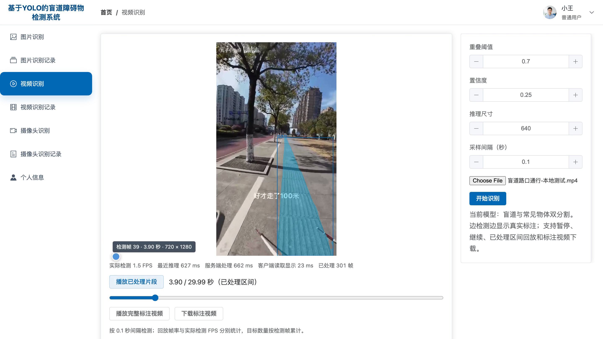

# bs170D
bs170D基于YOLO的盲道障碍物检测系统源码 Python Django Vue3
## 源码问题查看主页咨询

### 一、关键词
盲道障碍物检测、无障碍出行、导盲辅助、人行道占用、通行安全

### 二、作品包含
源码+数据库+全套环境和工具资源+本地部署教程

### 三、项目技术
前端技术： Html、Css、Js、Vue3.4、Element-Plus
后端技术：Python、Django、DRF、Ultralytics、PyTorch、OpenCV、YOLO11

### 四、运行环境要求
开发工具：PyCharm + VSCODE

数据库：MySQL5.7+（共8张表）

数据库管理工具：Navicat10以上版本

环境配置软件： Python3.13

前端Nodejs：20.19.5

浏览器：谷歌浏览器

### 五、项目介绍
项目编号：bs170D

本系统面向盲道通行场景，结合盲道与常见障碍物分割结果，提供图片、视频和摄像头识别，展示目标位置及占道状态，支持记录回看与模型管理，便于开展无障碍通行检测演示。

角色：用户、管理员

用户功能：图片识别与结果查看、视频识别及暂停继续、摄像头实时识别、识别记录检索与详情回看、标注视频播放与下载、个人资料及密码修改。

管理员功能：数据看板与任务统计、用户信息管理、多源画面识别、识别记录检索与详情查看、模型套件登记验证及启用、模型评估与图表查看、系统日志查询、个人资料及密码修改。

### 六、运行截图

